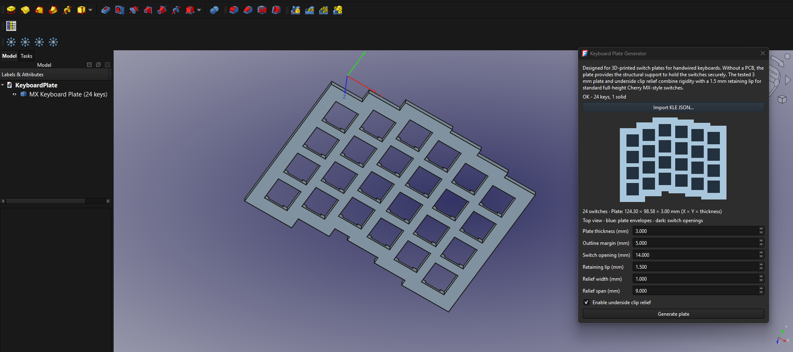

# Keyboard Plate Generator v0.1.0-beta.1

**By [Aniket Kharel](https://github.com/aniketkharel/) · eco-ergo.com · MIT License**

Generate editable, 3D-printable Cherry MX switch plates from [Keyboard Layout Editor (KLE)](https://www.keyboard-layout-editor.com/#/) JSON in FreeCAD. Optimized for handwired keyboards, where the plate supports the switches without a PCB. Plates can also be used in PCB-based builds when the mechanical layout and clearances match.

**Early beta:** The core plate-generation workflow is working, with print-tested reference geometry. Features and compatibility are still evolving; see the testing details and current limitations below.

## Preview



## Why this project exists

I started this because my workflow involved generating a keyboard plate on a website, exporting a DXF, and importing it into FreeCAD to continue the design. FreeCAD is my CAD tool of choice because it is open source. I wanted to import a layout and generate an editable, printable plate directly in FreeCAD.

I'm building this for my own custom handwired and split ergonomic keyboard projects, and sharing it so others can use it too. Eventually, I'd like it to grow into a reusable FreeCAD keyboard design workbench with plate and enclosure tools.

**eco-ergo.com is my upcoming project**, not an established product or service yet. My goal is to make ergonomic keyboards more affordable and accessible by sharing open-source designs and low-cost builds. This generator is one step in that direction.

## AI assistance and testing

**Yes, this project is AI-assisted.** I used AI to help write and refactor the code, build the interface, and prepare tests and documentation.

I've tested the workflow in FreeCAD and **3D printed a four-switch test plate on a Bambu Lab A1**. The switches clipped in correctly, and the plate was sturdy. The refactor preserves that tested switch geometry and its default dimensions. Automated tests and FreeCAD runtime checks also cover the cases listed in the validation section below.

I haven't tested every switch, layout, printer or PCB assembly, and I haven't printed every revision. The physical print verifies the reference fit; the software checks cover the refactored code. Known limitations are listed below so you can see what works, what was tested, and what's still missing.

## Installation

Extract the release ZIP into your FreeCAD macros folder. Keep this structure:

```text
plate_generator.FCMacro
keyboard_plate/
examples/
README.md
LICENSE
CHANGELOG.md
```

Run `plate_generator.FCMacro` from FreeCAD's Macros dialog. When upgrading, replace the launcher and the complete package folder together, then restart FreeCAD to clear previously imported modules.

## Use

1. Create or open your layout in [Keyboard Layout Editor](https://www.keyboard-layout-editor.com/#/) and use **Download JSON**. Click **Import KLE JSON…** and choose your layout, or `examples/four_switch_kle.json` or `examples/tough_test.json`.
2. Check the top-view preview, switch count and overall X × Y × thickness.
3. Adjust parameters and click **Generate plate**. Dimensions and preview update before generation.
4. Edit Data properties and recompute, or select an existing generator before running the macro to edit it in the dialog.
5. Save the document as FCStd. Select the plate and use FreeCAD's Export command for STL or STEP.

The package must be importable when FreeCAD restores a saved parametric object. In a new FreeCAD session, run the launcher before opening your FCStd document. If the document was already open without its proxy restored, select the plate and run the launcher to reattach its proxy through regeneration. Keep the installed package available; the FCStd embeds the layout and generated shape, not this Python package.

## Proven mechanical defaults

| Parameter | Default |
| --- | --- |
| Plate thickness | 3 mm |
| Switch opening | 14 × 14 mm |
| Top retaining lip | 1.5 mm |
| Underside clip relief | Enabled |
| Relief extension per clip side | 1 mm |
| Relief span | 9 mm |
| Outline margin | 5 mm |
| KLE unit pitch | 19.05 mm |

These defaults and the MX cutter construction preserve the successful four-switch Bambu Lab A1 print. Relief pockets are on the underside at the switch's local ±Y clip edges. No printer tolerance compensation is added. Intended for standard full-height Cherry MX-style plate-mounted switches; fit can vary with the switch housing and printing process. The 3 mm structure retains a 1.5 mm top lip for clip engagement.

## Using a plate with a PCB

PCB-based builds are supported as a mechanical use case; the generator does not design or read a PCB. Import a layout that matches your PCB's switch centers and rotations exactly.

Unchecking **Enable underside clip relief** removes the two underside pockets and leaves straight-through square openings. It does **not** change the plate thickness or automatically ensure PCB compatibility. Choose thickness and relief settings to suit your switch manufacturer's plate specifications and the assembly stack-up. A 3 mm plate without relief may prevent some retaining clips from engaging; relief can still be useful in a PCB build.

Before printing the full plate, verify:

- Switch centers, orientation, spacing and supported switch housings match the PCB.
- Plate thickness, switch seating and plate-to-PCB spacing allow pins to reach their solder pads or hot-swap sockets correctly.
- Underside clearance accommodates sockets, components and any relief pockets.
- Stabilizers and mounting hardware have the required cutouts and clearances. Stabilizer cutouts and mounting holes are not generated in this release.

The proven handwired defaults remain unchanged. PCB assembly fit has not been physically validated by this project; check a small sample with your actual PCB and switches.

## Layouts and preview

Accepts full [KLE](https://www.keyboard-layout-editor.com/#/) JSON arrays and comma-separated JSON rows without the outer array. Supports stagger, key sizes, rotation clusters and decals. JavaScript syntax with unquoted property names and QMK/VIA firmware JSON are not supported.

Blue preview regions represent expanded key envelopes; dark regions represent switch openings. Overall dimensions include rotated envelopes. The preview is a position and size check; generation separately validates connectivity and BREP geometry.

## Errors and limits

The generator requires one connected plate with positive volume and valid BREP. Disconnected layouts may require a larger outline margin. A failed property recomputation retains the previous valid shape and reports an error in GenerationStatus and FreeCAD's Report view. Failed dialog generation rolls back the document transaction.

**Mounting holes are not generated.** Add any screw holes and mounting features manually in FreeCAD to suit your case or base. Automatic mounting-hole support may be added in a future release.

**Stabilizer cutouts are not implemented yet.** Wider keys currently receive only a centered switch opening; importing a spacebar, Enter, Shift or other wide key does not add stabilizer holes. Stabilizer support may be added in a future release, but no release date or supported stabilizer types are committed.

One centered switch opening is created per physical key. The outline is a union of expanded rectangular key footprints. Stabilizer cutouts, secondary nonrectangular KLE footprints, mounting holes, OLED/controller mounts and case generation are not implemented. This release is a modular macro application, not a registered workbench.

## Compatibility and validation

I've checked the import dialog and preview in FreeCAD 1.1 on Windows. Compatibility imports are provided for PySide, PySide2 and PySide6; other FreeCAD versions have not been independently tested.

Automated checks cover parsing, preview coordinates, protected cutter construction and mechanical defaults. FreeCAD runtime checks cover the sample and a rotated layout, valid single solids, dimensions, bidirectional geometry differences, FCStd save/reopen in the same process, editable recomputation and last-valid-shape retention. The sample measures **48.1 × 48.1 × 3 mm**, volume **4480.83 mm³**. Fresh-process proxy restoration and recomputation also passed with the package importable; installed-path availability is still required.

## Development

The source workspace contains `tests/`, `tools/` and the unmodified v0.2 macro in `reference/`; these are excluded from the installation ZIP.

- `parameters.py`: shared mechanical defaults and property definitions.
- `kle.py`: FreeCAD-independent parser.
- `preview.py`: top-view coordinates and bounds.
- `geometry.py`: envelopes, preserved MX cutters, refinement and validation.
- `feature.py`: persistent parametric feature and property schema.
- `gui.py`: layout import, preview and transactional editing.

```text
python -m unittest discover -s tests -v
python -m compileall -q keyboard_plate
```

Run `tests/validate_freecad.py` with FreeCAD's bundled Python. It writes `validation_output/sample.FCStd`. The original v0.2 reference skips planar refinement because faces have zero volume, causing nine solids on this FreeCAD 1.1 runtime. The comparison corrects only that reference refinement before checking material equivalence; tested cutter construction remains unchanged.

Build the installation archive with `python tools/build_release.py`. It includes only the launcher, application sources, JSON examples, demo image, license and user documentation.

## Credits

[Keyboard Layout Editor](https://www.keyboard-layout-editor.com/#/) is created by **Ian Prest and contributors**. Thanks to them for the layout editor and the KLE data format used by this importer. This is my independent project, shared under **eco-ergo.com**; it is not affiliated with or endorsed by Keyboard Layout Editor. See the editor's website for its own source and license.
